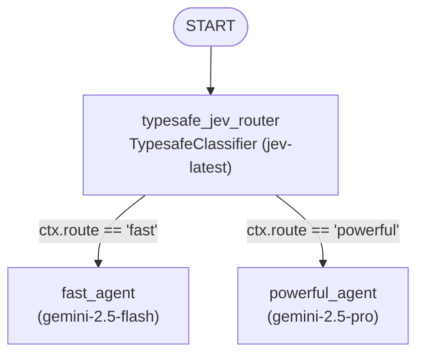

# ADK 2.0 Model Router with TypeSafe Jev (`TypesafeClassifier`)

Cost-aware prompt routing in **Google ADK (`>= 2.13.0`)** using **TypeSafe's Jev** System-1 decision model (`TypesafeClassifier`) to dynamically route requests between fast and frontier Gemini models.

## Overview

Traditional LLM routers require a full text-generation round-trip just to decide which downstream model should handle a request. This example ([`adk_model_router/agent.py`](adk_model_router/agent.py)) replaces LLM-based routing with `TypesafeClassifier` (`google.adk.integrations.typesafe`), introduced in `google-adk` **2.13.0**.

Instead of generating tokens, Jev (`jev-latest`) evaluates a typed `Choice` question (`google.adk.labs.classifiers`) in a **single forward pass** via TypeSafe's `/v1/systemone` API—returning calibrated probabilities, a confidence score, and the selected model tier (`fast` or `powerful`) to branch execution inside a declarative ADK 2.0 `Workflow`.

---

## Workflow Architecture



### Routing Tiers

| Route | Target Agent | Model | Routing Criteria (`ROUTING_QUESTION`) |
| :--- | :--- | :--- | :--- |
| `fast` | `fast_agent` | `gemini-2.5-flash` | Direct lookups, extraction, and localized changes. |
| `powerful` | `powerful_agent` | `gemini-2.5-pro` | Architecture and high-stakes decisions. |

---

## How It Works

The implementation in [`adk_model_router/agent.py`](adk_model_router/agent.py) is organized into four stages:

1. **Classifier & Typed Routing Question (`TypesafeClassifier` & `Choice`)**:
   - Configures `TypesafeClassifier(model="jev-latest")`, which authenticates using `TYPESAFE_API_KEY` from the environment.
   - Defines `ROUTING_QUESTION` as a `Choice` question instructing Jev to *"Choose the least costly model that can complete the task"* across the `fast` and `powerful` criteria.

2. **Target Model Agents (`Agent`)**:
   - **`fast_agent` (`gemini-2.5-flash`)**: Handles low-latency, low-cost tasks concisely and accurately.
   - **`powerful_agent` (`gemini-2.5-pro`)**: Handles complex architectural design and high-stakes reasoning.

3. **Jev Routing Node (`typesafe_jev_router`)**:
   - Normalizes the incoming `node_input` (`types.Content` parts, raw string, dictionary, or `ctx.state["prompt"]`) into plain prompt text.
   - Calls `await classifier.classify(input=prompt_text, questions={"model_tier": ROUTING_QUESTION})`.
   - Sets `ctx.route = answer.choice` (`"fast"` or `"powerful"`) and records Jev's calibrated telemetry into `ctx.state`.

4. **Declarative Workflow Graph (`Workflow` & `root_agent`)**:
   - Wires `START -> typesafe_jev_router_node` with dictionary-based conditional edges (`{"fast": fast_agent, "powerful": powerful_agent}`).
   - Exposes `root_agent` (re-exported in [`adk_model_router/__init__.py`](adk_model_router/__init__.py)) for ADK CLI and web server discovery.

### Session State Telemetry

On every turn, `typesafe_jev_router_node` persists Jev's decision metadata into `ctx.state` (inspectable in the `adk web` State tab):

| State Key | Type | Description |
| :--- | :--- | :--- |
| `prompt` | `str` | Normalized user prompt text evaluated by Jev. |
| `selected_route` | `str` | Chosen route label (`"fast"` or `"powerful"`). |
| `jev_probabilities` | `dict[str, float]` | Calibrated probability distribution across `"fast"` and `"powerful"`. |
| `jev_confidence` | `float` or `None` | Confidence score reported by Jev (when available). |
| `jev_model_version` | `str` or `None` | Concrete Jev model version that `jev-latest` resolved to. |

---

## Prerequisites & Setup

### 1. Create Virtual Environment & Install Dependencies

Requires Python `>= 3.11` and `google-adk >= 2.13.0`. From the `model-routing-with-adk-jev/` project root:

```bash
python3 -m venv .venv
source .venv/bin/activate
pip install "google-adk>=2.13.0"
```

### 2. Configure Environment Variables

Configure the `.env` file in the `model-routing-with-adk-jev/` root directory (or export in your shell) with your TypeSafe and Gemini credentials:

```bash
# Required by TypesafeClassifier
TYPESAFE_API_KEY=your_typesafe_api_key

# Option A: Google AI Studio
GOOGLE_GENAI_USE_ENTERPRISE=FALSE
GOOGLE_API_KEY=your_gemini_api_key

# Option B: Vertex AI (instead of Option A)
# GOOGLE_GENAI_USE_ENTERPRISE=TRUE
# GOOGLE_CLOUD_PROJECT=your-gcp-project
# GOOGLE_CLOUD_LOCATION=us-central1
```

---

## Running the Router

Run the commands below from the `model-routing-with-adk-jev/` root directory (with `.venv` activated):

**Interactive CLI:**

```bash
adk run adk_model_router
```

**ADK Web UI (recommended for inspecting graph routing & Jev probabilities):**

```bash
adk web
```

Then select **`adk_model_router`** from the agent dropdown in the web UI.

### Example Prompts to Try

- **Routes to `fast` (`gemini-2.5-flash`)**:
  > *"Extract all dates and dollar amounts from: Invoice #402 paid $1,250 on Oct 14, 2026."*
- **Routes to `powerful` (`gemini-2.5-pro`)**:
  > *"Design a multi-region active-active payment ledger architecture with strict idempotency and zero-RPO failover."*

---

## Project Structure

```text
model-routing-with-adk-jev/
├── .env                  # Environment variables (TYPESAFE_API_KEY, Gemini/Vertex credentials)
├── .venv/                # Python virtual environment
├── README.md             # Project documentation
└── adk_model_router/     # ADK agent package
    ├── __init__.py       # Re-exports root_agent for ADK CLI discovery
    └── agent.py          # TypesafeClassifier (Jev) router node, Gemini tier agents, and Workflow graph
```
